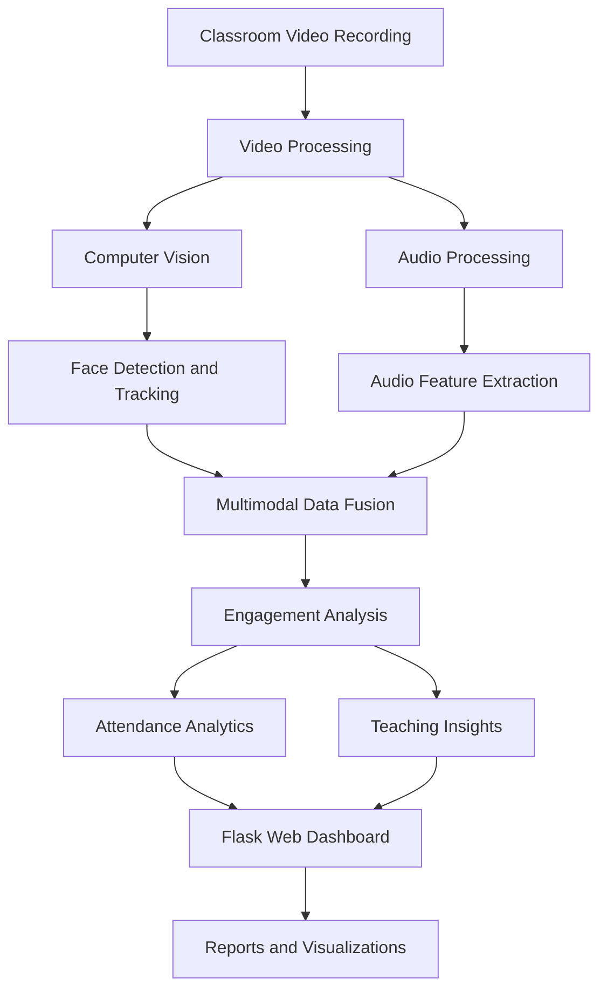
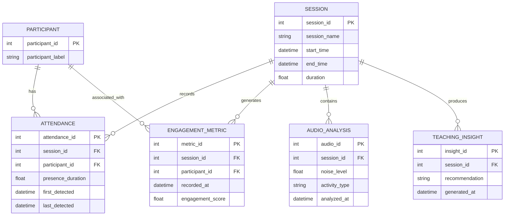

# Multimodal Attendance & Engagement Agent

<p align="center">
  **An Intelligent Classroom Monitoring and Engagement Analytics System**
</p>

<p align="center">
  Computer Vision | Audio Processing | Multimodal Data Fusion | Intelligent Insights
</p>

---

## Overview

The **Multimodal Attendance & Engagement Agent** is an intelligent classroom analytics platform designed to automate attendance monitoring, analyze classroom engagement, and generate meaningful teaching insights.

The system combines computer vision, audio signal processing, and multimodal reasoning to extract useful information from classroom sessions. It transforms video and audio signals into structured analytics, helping educators understand participation patterns and classroom activity.

An interactive web dashboard provides attendance summaries, engagement trends, session analytics, and instructor recommendations.

## Key Features

### 1. Computer Vision-Based Attendance
- Face detection from classroom video recordings.
- Participant detection and tracking.
- Face location and bounding-box visualization.
- Timestamp-based participant activity analysis.
- Attendance duration estimation.

### 2. Audio Signal Processing
- Audio extraction from supported video recordings.
- Audio activity analysis.
- Classroom sound-level assessment.
- Audio feature extraction for session analysis.

### 3. Multimodal Data Fusion
- Integration of visual and audio information.
- Timestamp-based activity alignment.
- Rule-based reasoning across multiple signal sources.
- Combined classroom activity analysis.

### 4. Engagement Analytics
- Session-level engagement assessment.
- Activity timeline generation.
- Participant presence analysis.
- Engagement trend visualization.
- Structured session analytics.

### 5. Intelligent Teaching Insights
- Automated analysis of classroom activity patterns.
- Context-aware teaching recommendations.
- Identification of potential engagement changes.
- Actionable insights to support instructional decisions.

### 6. Interactive Dashboard
- Web-based dashboard.
- Classroom session analysis.
- Attendance and engagement summaries.
- Interactive charts and visual reports.
- CSV-based report export.

---

## System Architecture



## Conceptual Entity Relationship Diagram

The following ER diagram represents the proposed logical data model for organizing classroom sessions, participants, attendance information, engagement measurements, and teaching insights.



### Entity Descriptions

| Entity | Description |
|---|---|
| SESSION | Stores classroom session information. |
| PARTICIPANT | Represents a participant detected during a session. |
| ATTENDANCE | Organizes participant presence and duration records. |
| ENGAGEMENT_METRIC | Represents engagement measurements over time. |
| AUDIO_ANALYSIS | Stores audio activity analysis results. |
| TEACHING_INSIGHT | Represents generated teaching recommendations. |

*Note: This is a conceptual database design for future structured storage. The current prototype's actual persistence implementation may differ.*

---

## Technology Stack

| Component | Technologies |
|---|---|
| Backend | Python, Flask |
| Computer Vision | OpenCV |
| Numerical Processing | NumPy |
| Audio Processing | MoviePy, FFmpeg |
| Frontend | HTML, CSS, JavaScript |
| Data Visualization | Chart.js |
| Development Environment | VS Code, Python 3.11 |

## Project Structure

```text
Multimodal_Attendance_System/
│
├── app.py
├── requirements.txt
├── README.md
│
├── core/
│   ├── __init__.py
│   ├── audio.py
│   ├── fusion.py
│   ├── insights.py
│   └── vision.py
│
├── static/
│   ├── script.js
│   └── style.css
│
├── templates/
│   └── index.html
│
└── uploads/
```

## Installation and Setup

### Prerequisites

- Python 3.11
- pip package manager
- Git
- Visual Studio Code (recommended)

### 1. Clone the Repository

```bash
git clone https://github.com/Akash120806/Multimodal_Attendance_System.git
```

### 2. Navigate to the Project

```bash
cd Multimodal_Attendance_System
```

### 3. Create a Virtual Environment

```bash
python -m venv .venv
```

### 4. Activate the Environment

**Windows PowerShell:**

```powershell
.venv\Scripts\Activate.ps1
```

### 5. Install Dependencies

```bash
python -m pip install --upgrade pip
pip install -r requirements.txt
```

### 6. Run the Application

```bash
python app.py
```

### 7. Open the Dashboard

Visit:

http://127.0.0.1:5000

---

## Application Workflow

1. Launch the Flask application.
2. Open the classroom analytics dashboard.
3. Provide a supported classroom video recording.
4. Process the recording through the analysis pipeline.
5. Extract visual and audio information.
6. Perform multimodal activity analysis.
7. Generate attendance and engagement insights.
8. Review the results through the dashboard.
9. Export session reports for further analysis.

## Project Objectives

- Automate classroom attendance analysis.
- Apply computer vision to classroom monitoring.
- Extract meaningful information from audio signals.
- Combine multiple data modalities for contextual analysis.
- Provide interpretable classroom engagement insights.
- Support educators through data-driven recommendations.

## Future Development

- Real-time webcam-based classroom monitoring.
- Advanced face tracking and participant identification.
- Live audio-video synchronization.
- Persistent database integration.
- Advanced machine learning-based engagement models.
- PDF report generation.
- Expanded analytics and visualization capabilities.

## Developer

**Akash Bhattacharya**

B.Tech Computer Science Engineering

GitHub: [@Akash120806](https://github.com/Akash120806)

## Repository

[Multimodal Attendance & Engagement Agent](https://github.com/Akash120806/Multimodal_Attendance_System)

---

<p align="center">
  **Building smarter classrooms through Computer Vision, Audio Intelligence and Multimodal AI.**
</p>
